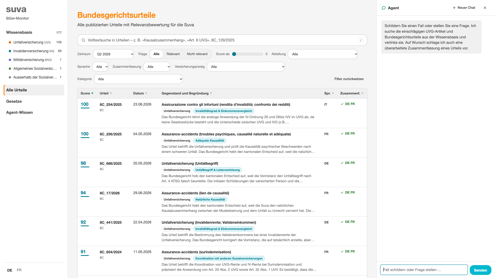
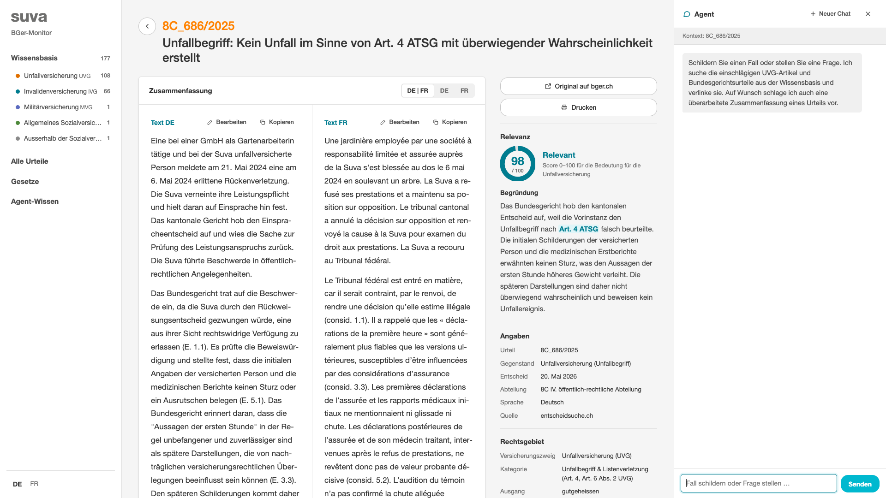
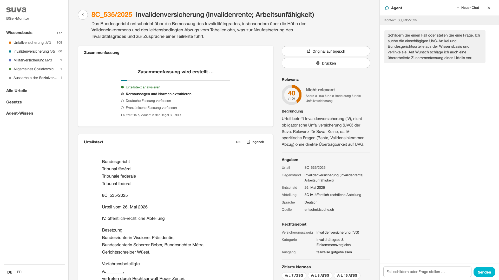
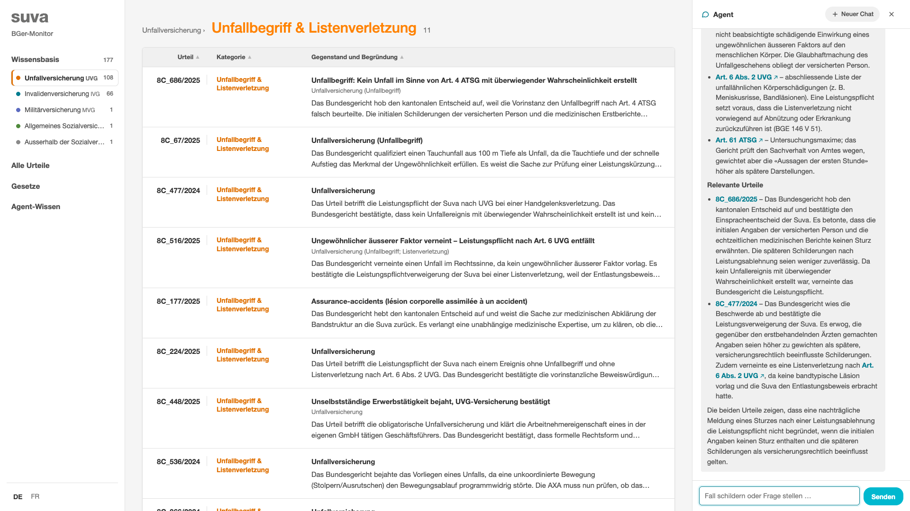

# Demo video script (max 2:00)

Shot list for the 2-minute demo of Praecedens. Every click, label and docket below was checked
in the running app (`make load` on a fresh database, `make run`, Chrome at 1920x1080) on
2026-11-27. UI labels are quoted exactly as the German UI shows them.

The audience is Suva's legal specialists: they will judge whether the top-ranked rulings are
really relevant and read 2-3 summaries. So the video spends most of its time on one top ruling
(score, reasoning, DE/FR summaries) and keeps the rest short.

## Rulings used

| Role | Docket | Why |
|---|---|---|
| Main ruling | **8C_686/2025** (20.05.2026, German, score 98, rank 3 of April-June) | Clear headline ("Unfallbegriff: Kein Unfall im Sinne von Art. 4 ATSG mit überwiegender Wahrscheinlichkeit erstellt"), classic Suva topic (accident definition, "Aussagen der ersten Stunde"), Suva is the appellant and wins, clean German reasoning, German original ruling so a German-speaking viewer can check the summary against the text. Both summaries recall the principle with a consideration reference (E. 3.3 / consid. 3.3). |
| Shown in the list only | 8C_254/2025 (rank 1, score 100) | Five-judge ruling: no analogous application of Art. 26bis IVV (10 % flat deduction) in accident insurance. Strongest headline of the quarter, but its German reasoning has two flaws ("keine 10%ige Pauschalabzug", "IV-OAI"), so do not open it on camera. Good backup if the team wants the landmark case: its summaries are clean and end with "Fünfer-Entscheid." |
| Summarise on demand | **9C_197/2026** (16.06.2026, German, score 27, "Nicht relevant") | Top of the "Nicht relevant" list for Q2 2026 (relevance threshold 28; the other score-27 ruling, 9C_241/2025, is older and sorts below it). Invalidity insurance ruling on a new application (Neuanmeldung) decided on an SMAB expert report: treating doctors who rate the capacity to work differently do not, on their own, call the report's probative value into question (E. 3.2.2, BGE 135 V 465). Suva relies on expert reports the same way in accident insurance. Short ruling (simplified procedure, Art. 109 BGG), so the live summary is quick. Has no summary after `make load`. |
| Score correction | **9C_197/2026** again | Right after its summary, the expert raises its score above the threshold of 28: the ruling becomes "Relevant" and joins the knowledge base, and the card keeps the model's own score ("KI-Score 27"). |
| Add a ruling | **8C_700/2024** (30.05.2025, German, not in the corpus) | Added by its number with "+ Urteil hinzufügen": downloaded from entscheidsuche.ch, classified (Unfallversicherung, natürliche Kausalität) and rated by Apertus (score 72, "Relevant"). Suva stopped its benefits on an expert report and won, which echoes shot 6. Cold, the add took 22 seconds. |
| Agent answer | links to 8C_686/2025 and 8C_477/2024 | The question below makes the agent search the knowledge base and cite the main ruling, which closes the loop of the story. |

## Shot list

Total: 2:00. Times are cut times in the final video, not recording times; the live summary,
adding a ruling and the agent answer take a while and are cut.

| # | Time | On-screen action | Must be visible | Caption / overlay | Voice-over (EN) |
|---|---|---|---|---|---|
| 1 | 0:00-0:10 | Title card, then the app opens on **Wissensbasis** (start page, `http://127.0.0.1:8000/#/`). No interaction. | Suva logo, "Praecedens", heading "Wissensbasis 268". | "Praecedens - Federal Supreme Court rulings for Suva, powered by Apertus" | "Every quarter the Federal Supreme Court publishes about two thousand rulings. Suva's lawyers search bger.ch by hand for the few dozen that matter to accident insurance." |
| 2 | 0:10-0:21 | In the left sidebar, hover the branch list under **Wissensbasis** ("Unfallversicherung UVG 108", "Invalidenversicherung IVG 157"). Click **Unfallversicherung**. In the first rows, click the orange category label **Unfallbegriff & Listenverletzung** (row 8C_686/2025). | Branch counts in the sidebar; then the breadcrumb "Unfallversicherung › Unfallbegriff & Listenverletzung" with its rulings. | "Knowledge base: relevant rulings by insurance branch and legal category" | "Praecedens fetches every ruling and keeps the relevant ones in a knowledge base, by insurance branch and legal category, each with a one-line headline." |
| 3 | 0:21-0:35 | Click **Alle Urteile** in the sidebar. Set **Zeitraum** to **Q2 2026**. Leave the sort on **Score ▼**. Slowly hover down the first rows (scores 100, 100, 98, 94, 92). | Column headers "Score", "Urteil", "Datum", "Gegenstand und Begründung", "Spr.", "Zusammenf."; the "DE FR" ticks in the last column. | "April-June 2026: 2,096 rulings, 131 rated by Apertus, 100 relevant" | "Here are all rulings of April to June 2026, ranked by relevance. A deterministic filter drops those unrelated to accident insurance; Apertus rates the rest, with a score and an explanation." |
| 4 | 0:35-0:49 | Click the row **8C_686/2025** (score 98). On the detail page, move the cursor to the right column: the **Relevanz** ring (98 / 100, "Relevant") and **Begründung**. Then click **FR** at the bottom of the left sidebar; the headline, "Pertinence" and "Motivation" switch to French. Click **DE** again. | Headline as page title; "Relevanz 98/100 Relevant"; the Begründung text with "Art. 4 ATSG" highlighted; in FR: "Notion d'accident: Pas d'accident au sens de l'art. 4 LPGA ...", "Motivation". | "Score and reasoning - written by Apertus in German and in French" | "Rank three: a ruling on the definition of an accident. The score comes with a reasoning, written separately in German and in French - the lawyer reads it in the language of the interface." |
| 5 | 0:49-1:07 | Stay on 8C_686/2025, summary tab **DE \| FR** (default). Highlight (zoom in post-production or select with the mouse) in **Text DE**: "Das Bundesgericht erinnert daran, dass die "Aussagen der ersten Stunde" in der Regel unbefangener und zuverlässiger sind ... (E. 3.3)". Then in **Text FR**: "« déclarations de la première heure »" ... "(consid. 3.3)". Then scroll the right column to **Zitierte Normen** and click the chip **Art. 4 ATSG ×3**: the page jumps to the highlighted citation in the ruling text (E. 1.2). | Both summary columns side by side, the footer "KI-generiert · 199 Wörter" / "215 Wörter"; the chips under "Zitierte Normen"; the highlighted "Art. 4 ATSG" in the Urteilstext. | "Two summaries in Suva's house style - written, not translated" | "The summaries follow Suva's house style: facts, the cantonal decision, the principle the Court recalls, its application and the outcome - every statement with its consideration. German and French are each written from the ruling, not translated. Every cited statute links to its passage in the original." |
| 6 | 1:07-1:21 | Click the back arrow (‹) to return to **Alle Urteile**. Click **Triage: Nicht relevant**. Click the first row **9C_197/2026** (score 27). Show "Noch keine Zusammenfassung" and the reasoning "Nicht relevant". Click **Zusammenfassen**. Show the progress card ("Zusammenfassung wird erstellt …", steps "Urteilstext analysieren" ... "Französische Fassung verfassen") for about 2 seconds. **Cut.** Show the finished DE \| FR summary columns and the toast "Zusammenfassung erstellt". Frame the summary card, not the page heading (see the note below the table). | Score ring 27 in grey, "Nicht relevant"; the cyan "Zusammenfassen" button; the progress card; then both summary columns. | "Summarise on demand"; during the cut: "Apertus 70B - cut" | "And the rulings the triage did not flag? This invalidity insurance ruling scored just below the threshold, but how much weight an expert report keeps against the treating doctors matters for accident insurance too. One click, and Apertus writes both summaries on demand." |
| 7 | 1:21-1:32 | Stay on 9C_197/2026 and scroll to the **Relevanz** card. Click **Anpassen**, drag the slider from 27 to about 45 (the label switches to "Relevant", "Erscheint in der Wissensbasis"), type a reason in "Begründung (optional)", click **Speichern**. | "Relevant", "Von Fachperson angepasst", "KI-Score 27", the expert's reason as Begründung; the toast "Score gespeichert". | "Experts correct the score - the model's own stays visible" | "A lawyer who disagrees corrects the score. Above the threshold, the ruling moves into the knowledge base; the model's own score stays visible, and the corrections are collected to improve the prompts." |
| 8 | 1:32-1:43 | Click **Alle Urteile**, then **+ Urteil hinzufügen**. Type **8C_700/2024**, click **Hinzufügen**. Show the progress card ("8C_700/2024 wird hinzugefügt …", steps "Urteil auf entscheidsuche.ch suchen und laden" ... "Relevanz für die Suva bewerten") for about 2 seconds. **Cut.** The new ruling opens: hover its score ring (72, "Relevant") and the Begründung. | The input with the docket; the progress card; then the detail page of 8C_700/2024 with score and reasoning and the toast "8C_700/2024 hinzugefügt". | "Add a ruling by its number"; during the cut: "cut" | "A ruling that is missing can be added by its number. Praecedens downloads it, classifies it, and Apertus rates it - here a Suva case on causation, scored 72." |
| 9 | 1:43-2:00 | Click **Unfallversicherung** in the sidebar, then the category label **Unfallbegriff & Listenverletzung** (the view of shot 2; 8C_686/2025 and 8C_477/2024 are rows 1 and 3). Do not ask from a detail page: there the agent gets that ruling as context ("Kontext: 9C_197/2026"). Click **Neuer Chat**, click into "Fall schildern oder Frage stellen …", type the question below, click **Senden**. Show "Der Agent recherchiert …" and "1 Tool-Aufruf" for a second. **Cut.** Show the answer, scrolled to "Relevante Urteile"; hover the link **8C_686/2025**. | The question bubble; the answer with "Relevante Normen" (Art. 4 ATSG, Art. 6 Abs. 2 UVG, Art. 61 ATSG with links) and "Relevante Urteile" (8C_686/2025, 8C_477/2024); the same two rulings in the list on the left. | "Legal assistant: searches the knowledge base, cites rulings and statutes" | "The lawyer can also describe a case. The assistant searches the knowledge base and the statutes and answers with links to the rulings - here, back to the accident ruling from the start." |

**Note on shot 6.** With the earlier shot-6 ruling (8C_535/2025) the summary run wrote a French
headline but no German one, and the German UI then showed the French headline as the page
heading. If the rehearsal run for 9C_197/2026 does the same, keep the heading out of frame after
the cut (start the "after" shot scrolled down to the summary card, or crop in post-production).
The pre-warmed cache replays the same result, so check the heading once after pre-warming.

### Agent question (shot 9)

Type exactly:

> Eine Versicherte meldet einen Sturz erst, nachdem die Suva Leistungen abgelehnt hat. Welche Urteile gibt es zu den Aussagen der ersten Stunde?

Asked twice in the test, the agent both times searched the knowledge base, read 8C_686/2025 and
8C_477/2024 and answered with an "Einschätzung", the statutes with fedlex links and both rulings
linked under "Relevante Urteile" - once in 106 seconds, once in about 5 minutes while the gateway
was busy. The agent is not cached, so the wording differs from run to run: read the answer before
using it. The first run listed "Art. 29 BV" with a dubious gloss ("umfasst auch die
Berücksichtigung der Aussagen der ersten Stunde"); if a line like that appears, re-run.

## Screenshots

From the test run (1920x1080, zoom 100 %, UI language DE):

- Shot 3, all rulings of Q2 2026 by score: 
- Shots 4-5, the main ruling opened from "Alle Urteile" (Relevanz, Begründung, DE \| FR summaries): 
- Shot 6, summarising a ruling the triage did not flag (progress card; taken with the earlier ruling 8C_535/2025, the layout is the same): 
- Shot 9, the agent's answer next to the category list of shot 2: 

## Preparation checklist

1. **Fresh database.** `make install`, then `make load` on an empty database (delete `data/suva.db`
   or point `DB_PATH` at a new file). Expected output: 6031 rulings, 3934 + 2096 triage results,
   3934 + 2096 classifications, 403 summaries and headlines. After loading, Q2 2026 has 100
   relevant rulings (score >= 28), all with summaries.
2. **Rulings that must already have summaries:** 8C_686/2025 (main ruling) and, for the list,
   8C_254/2025, 8C_256/2025, 8C_17/2026, 8C_441/2025 (the top 5). All come from
   `data/results/summaries_2026q2.jsonl`; check that their "Zusammenf." column shows "DE FR".
3. **Ruling that must not have a summary:** 9C_197/2026 (the "Zusammenfassen" button only shows
   when there is none), with no expert score. **Ruling that must not be in the database:**
   8C_700/2024. If a rehearsal summarised, corrected or added them, reload the database (step 1).
4. **LLM settings.** `.env` with `LLM_NAME`, `LLM_BASE_URL`, `LLM_API_KEY` (the summary step is
   pinned to `apertus-v1-5-70b`, the agent uses `AGENT_MODEL`, default `apertus-v1-5-70b`). Check
   with one agent question before recording.
5. **Pre-warm the live summary.** The summary writer caches every model response under
   `data/cache/llm/` (git-ignored, so do this on the recording machine, in the checkout you
   record from). Summarise 9C_197/2026 once on a scratch database:
   `DB_PATH=/tmp/warm.db make load && DB_PATH=/tmp/warm.db uv run suva summarize 9C_197/2026`.
   Clicking **Zusammenfassen** on the clean database then replays the same calls from the cache:
   in the test the replay took 4 seconds against about 20 minutes cold, with the same text. Keep
   the cut anyway (the progress card is paced by time, not by real progress). Pre-warm the add
   of 8C_700/2024 on the same scratch database (start it with `DB_PATH=/tmp/warm.db uv run suva
   serve --port 8091`, then `curl -X POST localhost:8091/api/rulings -H 'content-type:
   application/json' -d '{"docket":"8C_700/2024"}'`); the replay then answers in under a second,
   so the recorder holds the response for 4 seconds to show the progress card before the cut.
6. **Browser.** Chrome, window 1920x1080 (or record a 1920x1080 region), zoom 100 %, no
   bookmarks bar or extensions visible, hide the cursor highlight unless used for hovering. Use
   a fresh profile or clear the site's local storage, so the summary view is the default
   **DE \| FR** and the language is **DE**.
7. **UI language.** DE at the start (bottom of the left sidebar). It switches to FR only in
   shot 4 and back to DE right after.
8. **Agent panel.** It is open by default on the right. Click **Neuer Chat** before shot 9 so
   no rehearsal messages show.
9. **Start state for shot 1:** `http://127.0.0.1:8000/#/`, scrolled to the top.

## Fallbacks

- **Live summary slow or failing** (in the test run it took about 20 minutes cold on the busy
  shared gateway, while the UI says "dauert in der Regel 30–90 s"): use the pre-warmed cache
  (checklist step 5). If the gateway is down, record the progress card for 2 seconds, then cut
  to a summary that was produced earlier: summarise 9C_197/2026 the day before with
  `uv run suva summarize 9C_197/2026` on a second database and record the "after" state there.
  Never type or edit a summary by hand: summaries must come from Apertus.
- **Summary shows an error card** ("Die Zusammenfassung konnte nicht erstellt werden"): click
  **Zusammenfassen** again; responses already received are cached, so the retry continues where
  it stopped.
- **Agent slow** (2 to 5 minutes per answer in the test run): record the question, cut, and
  show the answer. If an answer is off or the run fails, click **Neuer Chat** and ask again.
  If it keeps failing, drop shot 9 and give its 16 seconds to shots 5 and 6.
- **Agent answers with raw tool text** (in one test run with the question "Gilt der
  Pauschalabzug von 10 % nach Art. 26bis Abs. 3 IVV auch in der Unfallversicherung?" the answer
  was a literal `read_article with law="UVV", art="25" ...` line): do not use that question;
  use the one above, and re-run if the answer is not a formatted text.
