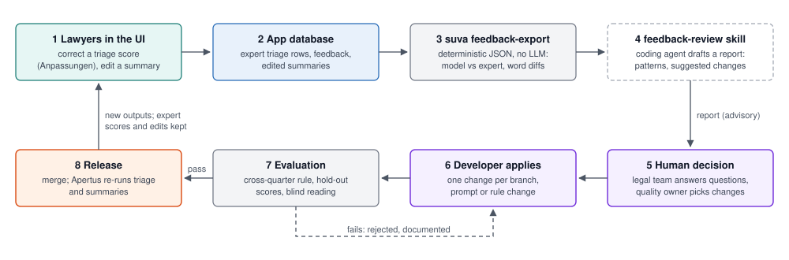

# Feedback loop: from expert corrections to better prompts

Suva's challenge asks the system to "learn from every correction the experts make". We let it
learn under human supervision: the lawyers' corrections are collected in the app, a coding
agent turns them into a report with suggested prompt changes, and people decide which change
to try, apply it and keep it only if the evaluation agrees. No prompt changes automatically, and
every relevance score and summary in the product is still written by Apertus.

*Purple: people decide. Grey: deterministic. Orange: Apertus. The dashed box is a coding agent
run by the supervisor; it only writes a report.*

## The steps

1. **Lawyers correct in the UI.** A lawyer overrides a triage score with an optional reason
   (the "Anpassungen", `PUT /api/rulings/{docket}/score`) or edits a summary
   (`PUT /api/rulings/{docket}/summaries/{lang}`, or by applying a proposal of the side-panel
   agent). The correction takes effect at once and later pipeline runs never overwrite it.
2. **The app keeps them.** Expert scores are triage rows with model `expert`, next to the
   model's own row; every correction is also logged in `feedback`. Edited summaries carry
   prompt version `edited`. The "Anpassungen" page can ask Apertus for a summary of the
   corrections (`adjustment_summaries`).
3. **Export (no LLM).** `uv run suva feedback-export --out feedback.json` writes all of it as
   one JSON file: each correction with the model's score, reasoning and prompt version, each
   edited summary with the generated text it replaced (from the `export-summaries` files in
   `data/results/`) and a word diff. Same database, same file.
4. **Report.** A quality supervisor runs the `feedback-review` skill
   (`.claude/skills/feedback-review/SKILL.md`) in a coding agent. The agent reads the export,
   the rulings and the current prompts, finds the rule or criterion behind each correction,
   checks every pattern against the labelled period and against changes that were already tried
   and rejected, and writes a markdown report: patterns, minimal suggested changes with
   evidence, expected effect and validation plan, corrections that need no change, and
   questions for the legal team. Example: `docs/examples/feedback_review_example.md`.
5. **Human decision.** The legal team answers the policy questions (what should count as
   relevant); the quality owner picks the suggestions worth trying.
6. **Developer applies.** One change per branch, with a new `PROMPT_VERSION` in `triage.py` or
   `summarize.py`, so old and new results stay apart.
7. **Evaluation.** Triage changes run on both labelled quarters and are kept only under the
   cross-quarter rule: neither quarter worse on P@10, P@30, R@30 or R@60
   (`docs/eval_triage.md`, `python -m suva.eval.score_triage`). Summary changes run on the
   hold-out and are compared with `python -m suva.eval.score_summaries --judge`
   (`docs/eval_summaries.md`) and a blind reading. The corrected rulings themselves are checked
   too. A change that fails is rejected and written down, like v4b and v4c were.
8. **Release.** The change is merged, the evaluation docs get the new row, and Apertus re-runs
   triage or summaries with the new version. The experts' own scores and edits stay in force.

## Why a human stays in the loop

- **Few corrections, many rulings.** A handful of corrections cannot show a pattern on their
  own, and a rule that fits them can hurt the rest: the explicit invalidity insurance rule of
  v4b fixed IV rulings and pushed listed accident insurance rulings out of the top 30. The
  report therefore counts how a suggested rule would act on the labelled period before anyone
  tries it.
- **Some corrections are policy, not errors.** Whether a routine ruling belongs in the
  knowledge base is Suva's decision; the report asks it instead of encoding a guess.
- **Product outputs stay Apertus-only.** The agent behind the report never writes a score or a
  summary and never changes a prompt; it suggests, people decide, and Apertus produces every
  output the product shows.
