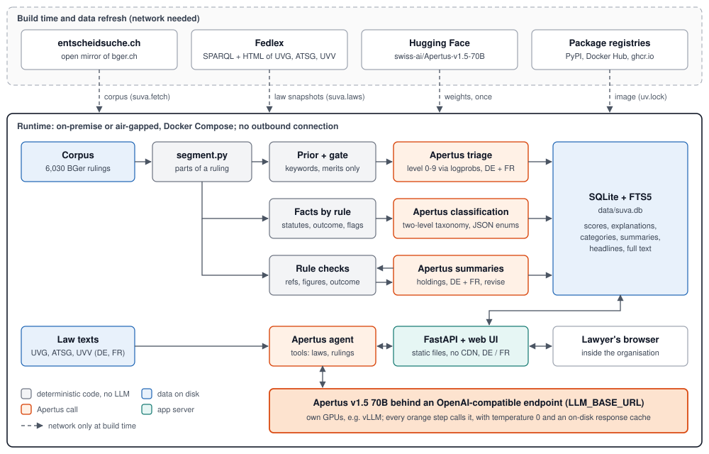

# Technical report - Praecedens, Vocare

- **Challenge partner:** Suva
- **Challenge:** Identification of relevant Federal Court judgements and preparation of a legal summary
- **Event:** On-site Zurich
- **Team:** Vocare - Lucas Bernoulli, Thomas Frei
- **Project:** Praecedens
- **Demo:** `[PLACEHOLDER: link to the demo video, added before submission]`

## 1. Summary

Suva's lawyers read the Federal Supreme Court's new rulings by hand. They pick the rulings
that matter for accident insurance and write a short summary of each, in German and in French.
Praecedens, a pipeline plus a web application, does this first pass for them:

- It loads every ruling of a period (about 2,000 per quarter) and ranks them by relevance to
  Suva, with an explanation in German and French.
- It sorts every social-law ruling into a two-level legal taxonomy.
- It writes German and French summaries in Suva's house style for the top-ranked rulings and
  stores everything in a searchable knowledge base.
- Lawyers can add any ruling by its number, correct a score, and edit or regenerate a summary.
  A legal assistant agent answers case questions from the rulings and the UVG, ATSG and UVV.

Every text the product shows comes from Apertus v1.5 70B. Everything else is plain code.
On the half-year Suva labelled (59 listed rulings), the top 60 holds 96 % of the listed rulings
in Q4 2025 and 77 % in Q1 2026. On 10 hold-out rulings, the summaries get the outcome right in
20 of 20 texts, but a blind reading found 31 factual errors. So a lawyer must review each
summary. The app runs on-premise or air-gapped, as Docker Compose with SQLite, and calls one
OpenAI-compatible Apertus API.

## 2. Architecture



*Figure 1 ([`docs/architecture.svg`](docs/architecture.svg)): grey boxes are plain code,
orange boxes call Apertus, blue boxes are data on disk. The Apertus API is an external service
outside the runtime. Apart from it, network access is needed only to refresh the data and to
add a single ruling by its number.*

| Component | Code | LLM | Role |
|---|---|---|---|
| Fetch | `src/suva/fetch/` | no | Downloads rulings from entscheidsuche.ch (6,030 rulings, 2025-10-01 to 2026-06-30) |
| Add a ruling | `ingest.py` | Apertus | One docket from entscheidsuche.ch: stored, classified and triaged |
| Segmenter | `segment.py` | no | Splits a ruling into rubrum, facts, numbered considerations, operative part, in DE/FR/IT |
| Triage | `triage.py` | Apertus | Keyword prior, merits gate, then a relevance level 0-9 with an explanation in DE and FR |
| Classification | `classify.py` | Apertus | Statutes, precedents, outcome and flags by rule; branch and legal category by Apertus |
| Summaries | `summarize.py`, `prompts/` | Apertus | DE and FR summaries and headlines, with rule checks and a factual check |
| Knowledge base, UI | `db.py`, `api.py`, `web/` | no | SQLite with FTS5 full-text search; FastAPI and a static DE/FR frontend |
| Agent | `agent/` | Apertus | Legal assistant with tools over the laws and the knowledge base |
| Laws | `laws.py`, `data/laws/` | no | UVG, ATSG and UVV from Fedlex in DE and FR, committed as JSON |

**Fetch.** bger.ch blocks scripts with a bot wall, so the crawler reads the open-data mirror
entscheidsuche.ch.

**Triage** (`docs/eval_triage.md`).

1. **Prior.** Code scores keywords, the division, Suva in the rubrum, UVG/UVV/ATSG citations
   and signs of substance (length, five-judge panel, upheld appeal). Below 20 points a ruling
   is not relevant, without an LLM call.
2. **Gate.** Code drops decisions that do not rule on the merits (not entertained, struck off,
   single-judge).
3. **Apertus** gets the criteria, base rates, Suva's example topics, glossary terms, the prior's
   hints and up to 30,000 characters of the ruling. It returns a level from 0 to 9 and a
   two-sentence explanation in each language.
4. **Score.** We read the probability the model gives each level (its "logprobs") and use the
   expected value, e.g. 7.4. A plain 0-100 score did not work: Apertus gave 85 to almost every
   accident insurance ruling. Final score = 70 % level + 30 % prior. 28 or more means relevant.

**Classification** (`docs/eval_classification.md`). Code extracts statutes, precedents, the
outcome and flags. Apertus reads each social-law ruling (1,150) and picks a branch and up to
three of 17 legal categories. A JSON schema with enums limits the answer to these values.

**Summaries** (`docs/eval_summaries.md`, style in `docs/style_guide.md`) take 10 to 16 Apertus
calls per ruling, plus about 25 short calls for the factual check:

1. Apertus lists the Court's holding for each numbered consideration.
2. Apertus writes both languages from the ruling; we do not translate. The style follows
   Suva's expected evaluator: facts, cantonal court, principles, their application, outcome,
   each statement with a consideration reference. Length: 150-200 words in German, 160-220 in
   French.
3. Code checks length, references, statutes, figures and dates against the ruling, no names,
   the outcome against the operative part, and glossary terms. Failures go back to Apertus.
4. Apertus compares the two languages and revises the one the ruling does not support.
5. **Factual check.** For each sentence, Apertus quotes the passage it relies on; a quote that
   is not in the ruling is dropped. Apertus then checks sentence against passage. Confirmed
   errors go to one revision. Code repoints or removes references to missing considerations.

**UI and agent.** The DE/FR UI lists every ruling of a period with a sortable score, the
explanation and taxonomy filters. It shows the original text, both summaries and headlines,
and summarises any other ruling on demand. "+ Urteil hinzufügen" adds a ruling by its number.
A lawyer's own score overrides the model's and survives later runs. The agent has six tools
(laws, rulings, search, propose a summary, memory) and at most 10 calls per question. It cites
rulings as links. A proposed summary replaces the stored one only when the lawyer accepts it.

### Target architecture (mandatory)

The project is deployable in all three settings. It is built for **a) on-premise** and
**b) air-gapped** operation. The same container also runs unchanged on **c) a sovereign Swiss
cloud** with a Swiss-hosted Apertus API.

- **One container plus the Apertus API.** `docker compose up --build` starts the API and UI on
  port 8000 and builds `data/suva.db` from the committed corpus and results (about 30 seconds).
  Every Apertus call goes to one OpenAI-compatible API, set by `LLM_BASE_URL`. We download no
  weights. For the hackathon this is the CSCS / Keera gateway. On-premise or air-gapped, the
  organisation serves the same API on its own GPUs, e.g. with vLLM (70B in BF16: two 80 GB GPUs).
- **No other third-party calls at runtime.** No CDN, web fonts or analytics. Law texts are
  committed snapshots. The one exception is "+ Urteil hinzufügen", which reads entscheidsuche.ch.
  Air-gapped, new rulings come with the corpus transfer instead.
- **API features used:** chat completions, `logprobs` (triage), `response_format: json_schema`
  (classification) and tool calls (agent).

| | Build time / data refresh (network) | Runtime |
|---|---|---|
| Code | Docker base images, PyPI packages pinned in `uv.lock` | none |
| Model | none, no weights are downloaded | the Apertus API (`LLM_BASE_URL`) |
| Rulings | `python -m suva.fetch`; air-gapped: run it on a connected machine and transfer the corpus | optional: one ruling by number |
| Laws | `python -m suva.laws` from Fedlex | none |

**Transfer to Azure (bonus).** The image runs on Azure Container Apps with `./data` on Azure
Files. The `LLM_*` variables point to an Apertus deployment, e.g. vLLM in Switzerland North. No
code changes are needed. Azure is US-owned, so for Swiss jurisdiction a Swiss provider fits
better.

## 3. Use of Apertus

We use Apertus v1.5 70B (`swiss-ai/Apertus-v1.5-70B`) through its OpenAI-compatible API, for
inference and for tool use (the agent). No fine-tuning, adapters or quantisation. All calls go
through `src/suva/llm.py`, a thin client with retries and an on-disk response cache.

| Step | Calls | Parameters |
|---|---|---|
| Triage | 1 per ruling that passes the gate | temperature 0, `logprobs`, top 10 |
| Classification | 1 per social-law ruling | temperature 0, JSON schema with enums |
| Summaries and headlines | 13-22 per ruling, plus about 25 for the factual check | temperature 0 |
| Corrections summary | 1 per request in "Anpassungen" | temperature 0 |
| Agent | up to 10 tool steps per question | temperature 0.2, native tool calls |

**What we tried and dropped**, each kept only if neither labelled quarter got worse: triage per
consideration (no better, 6.4 times the calls); cited statutes as a score; an explicit
invalidity insurance rule (raised all IV rulings); a few-shot example chosen by similarity
(the model copied its facts); Apertus as a judge of whole summaries (it found no errors).

**Hackathon rule compliance: only Apertus generates text.** Every explanation, category,
summary, headline and agent answer comes from Apertus. No summary in `data/results/` was
written or corrected by hand or by another LLM. A lawyer's edit in the UI is marked `edited`,
and none is in the submitted results. After Apertus, only rule-based code changes the text:
it normalises abbreviations, citations and amounts from the glossary, fixes a closing sentence
that contradicts the operative part, replaces a leftover anonymised name with the role, and
as a last resort deletes the sentences Apertus ranked as least needed. Other models appear
only in evaluation: Gemini in the baseline below, Claude sub-agents as blind readers.

**Apertus against a frontier cloud model** (`docs/eval_baseline_gemini.md`). We ran the same
code and prompts with Gemini 3.8 Flash. P@30 is the share of the top 30 that Suva listed;
R@60 is the share of Suva's listed rulings in the top 60.

| | Apertus 70B | Gemini 3.8 Flash |
|---|---|---|
| Triage P@30 / R@60, Q4 · Q1 | 0.70 / 0.93 · 0.63 / 0.77 | 0.67 / 0.89 · 0.67 / 0.84 |
| Category, primary correct (55 examples) | 0.75 | 0.80 |
| Summaries, 20 hold-out texts, without the factual check | 36 factual errors | 2 factual errors |
| Sovereignty | open weights, on-premise or air-gapped | US cloud API only |

Ranking and categories are on par. For summaries the cloud model is clearly ahead. We stay on
Apertus because rulings, drafts and internal notes must not leave Suva's network.

## 4. The challenge's measures and the bonus

**Recall and F2 on the delivered list.** Recall is the share of the rulings Suva wants that are
on our list. Precision is the share of our list that Suva wants. F2 combines both and weighs a
missed ruling four times as much as an extra one. The threshold of 28 has the best F2 on the
labelled half-year: recall 1.00, precision 0.35, F2 0.73 (168 rulings). The same threshold cuts
the delivered list (`deliverables/`): April-June 2026 has 100 rulings at 28 or more (61
invalidity, 38 accident, 1 military insurance).

**Top 5 summaries of June 2026.** The five highest-ranked June rulings are 8C_254/2025,
8C_17/2026, 8C_343/2025, 8C_184/2026 and 8C_365/2025. They and all 68 April-June rulings scored
50 or more have summaries in both languages (about 168 words in German, 195 in French).

**Product.** One UI covers the four steps: original text with a link to bger.ch, sortable
score, the reasoning in DE and FR, both summaries side by side, and "add another judgement".

**Bonus: redefine relevance, customise summaries, learn from changes.** Lawyers set their own
score and edit summaries. The agent's memory changes only when a lawyer says "Merke dir", and
can be read and reset. "Anpassungen" collects the score corrections. Nothing feeds back into
triage automatically: labels reflect Suva's capacity as much as relevance, and a rule that
helps one quarter can hurt the other. A person reviews every change (`docs/feedback_loop.md`).


*Figure 2 ([`docs/feedback_loop.svg`](docs/feedback_loop.svg)): purple, people decide; grey,
plain code; orange, Apertus. The dashed box is a coding agent that only writes a report.*

`uv run suva feedback-export` writes every correction as JSON. The `feedback-review` skill
(`.claude/skills/feedback-review/SKILL.md`) traces each correction to the prompt rule behind it,
tests a candidate rule on the labelled period, and writes a report with suggested changes,
evidence and a validation plan. It changes nothing itself. On five synthetic corrections and
one edited summary (`docs/examples/feedback_review_example.md`) it declined a general IV rule
the data does not support, proposed one narrow change, and found a real UVG/UVV error in a
summary.

## 5. Data

| Data | Source | Licence / status | Personal data |
|---|---|---|---|
| 6,030 Federal Supreme Court rulings, 2025-10-01 to 2026-06-30 (`data/corpus/`) | entscheidsuche.ch, open mirror of bger.ch | Official acts, no copyright (Art. 5 URG) | Anonymised by the Court; we do not de-anonymise |
| UVG, ATSG, UVV in DE and FR (`data/laws/`) | Fedlex | Official legal texts (Art. 5 URG) | none |
| 55 example summaries and the 59 rulings Suva listed in Q4 2025 / Q1 2026 (`judgements/`, `data/eval/`) | Suva, for the challenge | Challenge material | Authors by initials |
| Glossary DE=FR and style guide | Derived by us from Suva's examples | Project licence | none |

10 of the 55 examples are a hold-out that no prompt ever sees (`data/eval/split.json`).
Summaries never name parties, doctors or other insurers. Secrets, the database and the
response cache are not committed.

## 6. Limitations

- **Factual errors in summaries.** A blind reading of the 20 hold-out texts found 31 errors;
  3 texts had none. Examples: a rule of Art. 6 Abs. 2 UVG turned around, the stages of the
  procedure mixed up, a reference to a consideration that does not state the point. Summaries
  need a lawyer's review.
- **Invalidity insurance recall.** Suva lists about 8 % of IV rulings, and nothing we tried
  separates them. Seven of the 8 listed rulings outside the top 60 are IV rulings.
- **Labels reflect capacity, and we tuned on them.** A blind reader rated 7 of 17 unlisted
  accident insurance rulings in our top 30 as worth a summary, so precision understates the
  ranking. Numbers for a new quarter will be lower. April-June 2026 has no labels.
- **Evaluation is not lawyer-validated.** LLM sub-agents did the blind readings, quoting the
  ruling for every finding.
- **Coverage.** Only Federal Supreme Court rulings since October 2025; no cantonal decisions.
- **Latency.** On the shared gateway a summary takes several minutes. The UI pre-computes the
  top summaries and runs the rest on demand.
- **Not tested:** the 8B model, quantised weights, our own vLLM deployment, load beyond one team.

## 7. Reproducibility

`cp .env.example .env`, set `LLM_NAME`, `LLM_BASE_URL` and `LLM_API_KEY`, then run
`docker compose up --build` and open http://127.0.0.1:8000 (details in the README, "Running
it"). The committed results make the UI work without calling Apertus. The app runs on a laptop
(Python 3.12, uv); triage of a quarter took 5-40 minutes with 8-12 parallel calls. Temperature
is 0 except where section 3 says otherwise. The gateway is not bit-for-bit deterministic, but
every response is cached under `data/cache/llm/`, so a rerun with the same prompts is exact.
The submission commit is `621e87d` (main, 2026-11-28); later commits only add this report and
its PDF.

```sh
make install load                                   # results as submitted, no LLM needed
uv run suva triage --from 2026-04-01 --to 2026-06-30
uv run suva classify --from 2026-04-01 --to 2026-06-30
uv run suva summarize-relevant --from 2026-04-01 --to 2026-06-30 --min-score 50
uv run python -m suva.eval.score_triage data/results/triage_2025q4_2026q1.jsonl --threshold 28
uv run python -m suva.eval.score_classification
uv run python -m suva.eval.score_summaries generated.jsonl   # hold-out, see docs/eval_summaries.md
```

**Results at a glance** (details in `docs/eval_*.md`).

| What | Measure | Result |
|---|---|---|
| Triage, Q4 2025 · Q1 2026 | P@10 / P@30 / R@60 | 0.90 / 0.70 / 0.96 · 0.60 / 0.60 / 0.77 |
| Triage, both quarters | recall / precision / F2 at score ≥ 28 | 1.00 / 0.35 / 0.73 (168 rulings) |
| Triage, April-June 2026 | 2,096 rulings: pre-filter / gate / Apertus / relevant | 1,908 / 57 / 131 / 100 |
| Classification, 55 examples | primary category / branch | 0.75 / 0.98 |
| Summaries, 10 hold-out × DE/FR | outcome right / factual errors / error-free | 20 of 20 / 31 / 3 |
| | ROUGE-L / chrF (overlap with Suva's text), DE · FR | 0.19 / 43.1 · 0.25 / 41.1 |

## License

Creative Commons Attribution 4.0 (CC-BY-4.0). All HackApertus projects are open-sourced.
The code is under Apache-2.0 (`LICENSE`).

## References

1. Swiss AI Initiative, Apertus v1.5 70B: https://huggingface.co/swiss-ai/Apertus-v1.5-70B
2. Swiss Federal Supreme Court, case law: https://www.bger.ch
3. entscheidsuche.ch, open-data mirror of Swiss court decisions: https://entscheidsuche.ch
4. Fedlex, the publication platform for federal law (UVG SR 832.20, ATSG SR 830.1,
   UVV SR 832.202): https://www.fedlex.admin.ch
5. Bundesgesetz über das Urheberrecht (URG), Art. 5, SR 231.1.
6. vLLM, an OpenAI-compatible inference server: https://github.com/vllm-project/vllm
7. Project documents: `docs/eval_triage.md`, `docs/eval_classification.md`,
   `docs/eval_summaries.md`, `docs/eval_baseline_gemini.md`, `docs/style_guide.md`.
