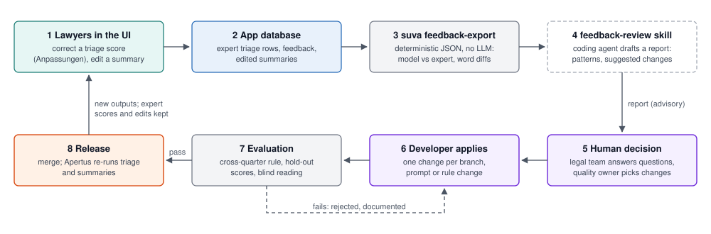

# Technical report - Praecedens, Vocare

A deeper write-up than the README: what we built, how it works, and what the
numbers say.

- **Challenge partner:** Suva
- **Challenge:** Identification of relevant Federal Court judgements and preparation of a legal summary
- **Event:** On-site Zurich
- **Team:** Vocare - Lucas Bernoulli, Thomas Frei
- **Project:** Praecedens
- **Demo:** `[PLACEHOLDER: link to the demo video, added before submission]`

## 1. Summary

Suva's lawyers search the Federal Supreme Court's publications by hand, pick the rulings that
matter for accident insurance and write a short summary of each in German and in French. We
built Praecedens, a pipeline and a web application that do the first pass for them. It loads every ruling
of a period (about 2,000 per quarter), ranks them by relevance to Suva and explains each rating
in German and French. It sorts every social-law ruling into a two-level legal taxonomy, writes a
German and a French summary in Suva's house style for the top-ranked rulings, and stores all of
it in a searchable knowledge base. Lawyers can add any further ruling by its number, correct a
relevance score, and edit or regenerate a summary. A legal assistant agent answers case
questions from the rulings and from the UVG, ATSG and UVV. Every text the product shows comes
from Apertus v1.5 70B. Everything else is deterministic code: fetching, segmentation, a keyword
prior and a gate, fact extraction and rule checks.

The ranking is tuned on the half-year Suva labelled (59 listed rulings in Q4 2025 and Q1 2026),
keeping a change only if it made neither quarter worse. All 59 pass the deterministic
pre-filter and gate; the top 60 holds 96 % (Q4) and 77 % (Q1) of them, and the misses are mostly
invalidity insurance. On 10 hold-out rulings never shown to the model, the summaries follow the
evaluator's structure and state the outcome right in 20 of 20 texts. Their weakness is factual:
a blind reading found 31 errors in the 20 texts (43 before v7's factual check), so a lawyer must
review each summary. The system runs on-premise or air-gapped, as Docker Compose with SQLite and
one OpenAI-compatible Apertus endpoint.

## 2. Architecture


*Figure 1 ([`docs/architecture.svg`](docs/architecture.svg)): grey boxes are deterministic
code, orange boxes call Apertus, blue boxes are data on disk. Network access is needed only at
build time, to refresh the data and to add a single ruling by its number.*

| Component | Code | LLM | Role |
|---|---|---|---|
| Fetch | `src/suva/fetch/` | no | Downloads rulings from the entscheidsuche.ch mirror into `data/corpus/rulings.jsonl.gz` |
| Add a ruling | `ingest.py` | Apertus | One docket from entscheidsuche.ch: stored, classified and triaged |
| Segmenter | `segment.py` | no | Splits a ruling into rubrum, facts, numbered considerations (admissibility, substance, costs), operative part and signature, in DE/FR/IT |
| Triage | `triage.py` | Apertus | Keyword prior, merits gate, then a relevance level 0-9 with an explanation in DE and FR |
| Classification | `classify.py` | Apertus | Statutes, precedents, outcome and flags by rule; branch and legal category by Apertus |
| Summaries | `summarize.py`, `prompts/` | Apertus | DE and FR summaries plus one-line headlines, with rule checks, a factual check and revisions |
| Expert scores | `db.py`, `adjustments.py` | Apertus | Lawyers' score corrections, and a summary of what they have in common |
| Knowledge base | `db.py` | no | SQLite with FTS5 full-text search over rulings and summaries |
| API and UI | `api.py`, `web/` | no | FastAPI JSON API and a static DE/FR frontend served by the same process |
| Agent | `agent/` | Apertus | Legal assistant with tools over the laws and the knowledge base |
| Laws | `laws.py`, `data/laws/` | no | UVG, ATSG and UVV from Fedlex in DE and FR, committed as JSON |

**Fetch.** bger.ch blocks scripted access with an Imperva/hCaptcha bot wall. The crawler
therefore reads the open-data mirror of entscheidsuche.ch, which publishes one metadata and one
HTML file per decision. The committed corpus holds all 6,030 rulings decided from 2025-10-01 to
2026-06-30.

**Triage** (prompt `v5`, `docs/eval_triage.md`) runs in four steps:

1. A deterministic prior scores the subject line, division, Suva/CNA in the rubrum,
   UVG/UVV/ATSG citations and insurance mentions, plus a ranking-only adjustment for substance
   (length, five-judge panel, an IV appeal by the IV office or a pension fund, an upheld
   appeal; minus for the simplified procedure). Below 20 points a ruling is labelled not
   relevant without an LLM call, with a DE/FR explanation listing the hints found.
2. A deterministic gate drops decisions that do not rule on the merits: not entertained or
   struck off, single-judge, or without a substantive consideration.
3. Apertus 70B reads the criteria, the base rates of the labelled period, the topics of Suva's
   few-shot examples, the matching DE=FR glossary terms, the prior's hints and up to 30,000
   characters of the ruling. It returns a level from 0 to 9 and a two-sentence explanation in
   each language, each written in its own legal language and checked for it.
4. The level is read from the token logprobs as an expected value (7.4, not 7): asked for a
   0-100 score, Apertus gave 85 to almost every accident insurance ruling. Final score = 70 %
   level + 30 % prior; 28 or more is labelled relevant, the cut-off with the best F2 on the
   labelled period (section 4).

**Classification** (prompt `v4`, `docs/eval_classification.md`). Statutes, precedents
(BGE/ATF/DTF), the outcome and flags (five-judge panel, public deliberation, intended for
publication) are extracted by rule. Every ruling of the social-law divisions (8x/9x, 1,150
rulings) goes to Apertus, which picks a branch (UVG, IVG, MVG, ATSG/other, outside social
insurance) and a primary plus up to two secondary categories from a closed list of 17, under a
JSON schema with enums.

**Summaries** (prompt `v7`, `docs/eval_summaries.md`, style in `docs/style_guide.md` section 11)
take 10 to 16 Apertus calls per ruling, plus about 25 short calls for the factual check:

1. Source: the ruling without costs, legal aid and the notification list (up to 70,000
   characters).
2. Holdings: Apertus lists the Court's conclusion for each numbered consideration, after the
   model once merged two considerations and inverted a holding.
3. Two originals: both languages are written from the ruling, the second with the first as an
   outline, because Suva's own second-language texts are translations with artefacts. The style
   follows the expected evaluator VIL (facts, cantonal court, principles recalled, their
   application, outcome; a consideration reference closes each statement) at 150-200 words in
   German and 160-220 in French, with two of her summaries as few-shot anchors.
4. Rule checks: length, references and statutes that exist in the ruling, figures and dates
   that occur in it, no names or birth years, Suva only as a party, no sentence that decides the
   appeal against the operative part, the target language's abbreviations and glossary terms.
   Failures go back to Apertus; an overlong text is shortened by Apertus or, as a last resort,
   cut by the sentences Apertus ranks as least needed.
5. Consistency: Apertus compares the two texts and names the version the ruling supports; the
   other one is revised.
6. Factual check (v7): for each sentence, Apertus copies the passage of the ruling it relies on
   (dropped unless it is word for word in the ruling), then compares the pair for the error
   types of the blind reading: who decided what, a rule with the wrong meaning, facts, figures
   of another stage. A flagged pair is asked about once more, narrowly; confirmed errors go to
   one revision. References are then checked by rule against the segmented ruling, down to
   E. 3.3.2, and one to a missing consideration or to the costs is repointed or removed. Asked
   for errors in the whole summary at once, Apertus found none in any of the 20 hold-out texts.
7. Finishing: deterministic normalisation (section 3). Each run also writes a headline per
   language of at most about 12 words.

**Knowledge base, UI and agent.** Results live in SQLite with an FTS5 index. The UI (DE/FR)
lists every ruling of a period with a sortable score, the explanation, badges and filters for
the taxonomy (advanced filters behind "Erweitert"). It shows the original text, both summaries
and headlines, and has a button to summarise any further ruling on demand. "+ Urteil
hinzufügen" takes a ruling number (also `8c 129/2025` or `8C-129-2025`), looks it up on
entscheidsuche.ch, stores, classifies and triages it, and opens it. A lawyer can set their own
score with a reason; it overrides the model's score, survives later triage runs and moves the
ruling into or out of the knowledge base. The view "Anpassungen" lists the corrections next to
the model's scores (section 4). The agent uses six tools: `read_article`, `list_rulings`,
`search_rulings`, `read_ruling`, `propose_summary` and `update_memory`, at most 10 calls per
question, and answers in the user's language with clickable citations. A docket it cites
without having seen it in a tool result is sent back once. A summary it proposes replaces the
stored one only when the lawyer accepts it, and is then marked `edited`.

### Target architecture (mandatory)

The project is deployable in all three settings. It is built for **a) on-premise** and
**b) air-gapped** operation, and the same container runs unchanged on **c) a sovereign Swiss
cloud** with a Swiss-hosted Apertus endpoint.

- **One container plus one model endpoint.** `docker compose up --build` starts the API and UI
  on port 8000 and builds `data/suva.db` from the committed corpus and results (about 30
  seconds). The only runtime peer the product needs is `LLM_BASE_URL`, an OpenAI-compatible
  endpoint serving Apertus, e.g. vLLM on the organisation's GPUs (BF16 70B: about 140 GB, two
  80 GB GPUs).
- **No third-party calls at runtime.** No CDN, web fonts or analytics; the law texts are
  committed snapshots; "open on bger.ch" is a plain hyperlink. The one exception is "+ Urteil
  hinzufügen", which reads entscheidsuche.ch; air-gapped, new rulings come with the corpus
  transfer instead.
- **Endpoint features used:** chat completions, `logprobs`/`top_logprobs` (triage),
  `response_format: json_schema` (classification), and tool calls (agent).

| | Build time / data refresh (network) | Runtime |
|---|---|---|
| Code | Docker base images (Docker Hub, ghcr.io), PyPI packages pinned in `uv.lock` | none |
| Model | Apertus weights from Hugging Face, once | local endpoint only |
| Rulings | `python -m suva.fetch` from entscheidsuche.ch; air-gapped: run it on a connected machine and transfer the corpus file | optional: one ruling by number |
| Laws | `python -m suva.laws` from Fedlex SPARQL | none |

**Transfer to Azure (bonus).** The image runs on Azure Container Apps or App Service with
`./data` on an Azure Files volume. The three `LLM_*` variables point to an Apertus deployment,
e.g. vLLM on a GPU node in Switzerland North. No code changes are needed. Azure is a US-owned
provider, so for jurisdiction (option c) a Swiss provider hosting Apertus is the closer fit.

## 3. Use of Apertus

- **Model:** `swiss-ai/Apertus-v1.5-70B`, the regular instruct model (gateway id
  `apertus-v1-5-70b`, the default when `LLM_NAME` is empty). The app warns if `LLM_NAME` names a
  thinking variant.
- **How it is used:** inference (triage, classification, summaries, headlines, the corrections
  summary) and agents / tool use (the legal assistant). No fine-tuning, no adapters, no
  quantisation on our side.
- **Where it runs:** for the hackathon, the CSCS / Keera gateway (`https://gateway.keera.ch`);
  in production, any OpenAI-compatible server the organisation runs, set by `LLM_NAME`,
  `LLM_BASE_URL` and `LLM_API_KEY`.

| Step | Prompt | Calls | Parameters |
|---|---|---|---|
| Triage | `triage.py` (`v5`) | 1 per ruling that passes the gate | temperature 0, `logprobs`, top 10, 900 tokens |
| Classification | `classify.py` (`v4`) | 1 per 8x/9x ruling, up to 3 on an invalid reply | temperature 0, JSON schema with enums |
| Summaries | `prompts/summary_*.md` (`v7`) | 10-16 per ruling, plus about 25 for the factual check | temperature 0; 0.4 only to redraw a rejected shortening |
| Headlines | `prompts/headline.md` (`v3`) | 3-6 per ruling | temperature 0 |
| Corrections summary | `prompts/adjustments_summary.md` | 1 per request in "Anpassungen" | temperature 0, 1,200 tokens |
| Agent | `agent/prompt.md` | up to 10 tool steps per question | temperature 0.2, native tool calls |

All calls go through `src/suva/llm.py`, a thin OpenAI client with retries and an on-disk
response cache keyed by model, messages and parameters.

**Model choice.** The thinking variant of the 70B reasoned on our long prompts only when the
assistant turn was prefilled; its summaries were better on 3 rulings and worse on 4, and it
called the IV office "l'assureur-accidents". So all steps use the regular 70B.

**What we tried and dropped**, each tested with the cross-quarter rule: map-reduce triage per
consideration (within noise for 6.4 times the calls; its segmenter and gate were kept, and the
gate saves 27 % of the calls); cited statutes as a score component and an explicit invalidity
insurance rule (the second raised all IV rulings, listed or not); for summaries, a third
few-shot example chosen by similarity (the model copied its facts), Apertus as a judge (it rated
a correct summary as reversing the outcome), and in v7 moving every reference to the
consideration of its passage (it broke six correct references while fixing one).

**Hackathon rule compliance: only Apertus generates text.** Every explanation, category,
summary, headline and agent answer the product shows comes from Apertus. No summary in
`data/results/` was written or corrected by hand or by another LLM. The UI can store a
lawyer's edit or score, but it is marked `edited` or "Von Fachperson angepasst", and none is in
the submitted results. The post-processing after Apertus is rule-based: the other language's
statute abbreviations replaced from the glossary; citation format, Swiss amounts, "Suva" for
"CNA" and French superscripts normalised; a word copied with a typo takes the ruling's spelling;
a closing sentence with the wrong result or party becomes a standard formula from the rubrum and
the operative part; a reference to a consideration that does not exist is repointed or removed;
the insured person's gender comes from the parties block and a leftover anonymised name becomes
the role; "Fünfer-Entscheid." / "Décision à cinq." is added; and, as a last resort, sentences
Apertus ranked as least needed are deleted.

The German few-shot anchors (`src/suva/prompts/style_examples_de.json`) are German renderings
of VIL's French originals. They are prompt input, never output. Other models appear only in
evaluation: Gemini in the baseline below, and Claude sub-agents as blind readers in the
summary readings and the reading studies.

**Apertus against a frontier cloud model.** `docs/eval_baseline_gemini.md` reruns the same
code and prompts (summaries `v6`) with Gemini 3.8 Flash (thinking off). Gemini's numbers come
from an untuned transfer: every prompt was tuned on Apertus.

| | Apertus 70B | Gemini 3.8 Flash |
|---|---|---|
| Triage P@30 / R@60, Q4 · Q1 (generated level for both) | 0.70 / 0.93 · 0.63 / 0.77 | 0.67 / 0.89 · 0.67 / 0.84 |
| Category, primary correct (55 examples) | 0.75 | 0.80 |
| Summaries v6, blind reading (20 texts) | outcome right 20/20; 36 factual errors; 2 error-free | outcome right 20/20; 2 factual errors; 18 error-free; preferred 20/20 |
| Time per summary (median) | 268 s on the shared gateway | 69 s |
| Sovereignty | open weights, on-premise or air-gapped | US cloud API only |

Ranking and categories are on par; summaries are where the cloud model is clearly ahead. v7
closes part of the gap: stricter readers counted 43 errors for v6 and 31 for v7, no text worse.
We stay on Apertus because rulings, drafts and internal notes must not leave Suva's network.

## 4. The challenge's measures and the bonus

**Recall and F2 on the delivered list.** Suva scores the list of April-June 2026 rulings we
call relevant by recall and F2, which weighs a missed ruling four times as much as an extra
one. The triage threshold of 28 was chosen for F2 on the labelled half-year: it is the best
cut-off on Q1 2026 (F2 0.708) and keeps recall 1.00 on the held-out Q4 2025 (F2 0.757). Pooled
it gives recall 1.00 and precision 0.35 (168 rulings), F2 0.73, against recall 0.85 and
precision 0.46 (109 rulings), F2 0.72, at the earlier threshold of 50. The same threshold labels
rulings relevant in the app, fills the knowledge base and cuts the delivered list
(`deliverables/`): April-June 2026 has 100 rulings at 28 or more (61 invalidity, 38 accident,
1 military insurance), 68 of them at 50 or more.

**Top 5 summaries of June 2026.** Suva checks our summaries of rulings it summarised in June
2026 against its own. The five highest-ranked rulings decided in June 2026 are 8C_254/2025
(rank 1, five-judge), 8C_17/2026, 8C_343/2025, 8C_184/2026 and 8C_365/2025; all have v7 summaries
in both languages. Every April-June ruling scored 50 or more (68) has a v7 summary; they average about 168 words in German
and 195 in French, none over the limit. No measure we have predicts Suva's verdict on these
texts: the hold-out reading above is our closest proxy.

**Product.** The four steps are in one UI: original text (with a link to bger.ch), sortable
score, the reasoning in DE and FR, both summaries side by side, and "add another judgement" as
both "+ Urteil hinzufügen" (by number) and "Zusammenfassen" (any stored ruling on demand).

**Bonus: redefine relevance, customise summaries, learn from changes.** Lawyers redefine
relevance per ruling with their own score, and customise summaries by editing them or by
accepting an assistant's proposal. Learning is human-supervised by design. The assistant's
knowledge text changes only when a lawyer says "Merke dir" and can be read and reset on the
"Agent-Wissen" page. Score corrections are collected, and "Anpassungen" turns them into proposed
rules for the triage prompt, but nothing feeds back into triage automatically: the labels
reflect Suva's capacity as much as relevance, one quarter holds only about 30 listed rulings,
and our own tuning showed that a rule that helps one quarter can hurt the other. A proposed
change is adopted only after a person has reviewed it and the cross-quarter check holds
(`docs/feedback_loop.md`).



*Figure 2 ([`docs/feedback_loop.svg`](docs/feedback_loop.svg)): purple, people decide; grey,
deterministic; orange, Apertus. The dashed box is a coding agent that only writes a report.*

**The feedback-review skill.** `uv run suva feedback-export` writes every correction as JSON
(no LLM). A quality supervisor then runs the `feedback-review` skill
(`.claude/skills/feedback-review/SKILL.md`) in a coding agent: it reads the export, the rulings
and the current prompts, traces each correction to the prompt criterion or rule behind it,
counts how a candidate rule would act on the labelled period, checks it against changes already
rejected, and writes a report with minimal suggested changes, evidence, expected effect and a
validation plan, plus questions for the legal team. It changes no prompt and no output. Its
first run, on five synthetic score corrections and one edited summary
(`docs/examples/feedback_review_example.md`), traced three raised IV rulings to a criterion
the prompt already has, declined a general IV rule because the labelled period does not support
it (the rejected v4b), proposed one narrow change (the IV helplessness allowance: 3 of 9 listed
against 1 in 10 for IV overall), found a real UVG/UVV error in a summary that points to the
factual-check prompt, and passed the two lowered accident insurance rulings to the legal team
as a policy question.

## 5. Data

| Data | Source | Licence / status | Personal data |
|---|---|---|---|
| 6,030 Federal Supreme Court rulings, 2025-10-01 to 2026-06-30 (`data/corpus/`) | entscheidsuche.ch open-data mirror of bger.ch | Court decisions are official acts, not protected by copyright (Art. 5 URG) | Anonymised by the Court ("A.________"); we do not de-anonymise |
| UVG, ATSG, UVV in DE and FR (`data/laws/`) | Fedlex SPARQL endpoint and HTML | Official legal texts (Art. 5 URG) | none |
| 55 example summaries in DE/FR and the list of 59 rulings Suva summarised in Q4 2025 / Q1 2026 (`judgements/`, parsed into `data/eval/`) | Suva, provided for the challenge | Challenge material | Authors identified by initials (FRT, LC4, VIL) |
| Glossary DE=FR (`data/eval/glossary.json`) and style guide | Derived by us from Suva's examples | Project licence | none |

The 55 examples are split into a few-shot pool and a hold-out of 10 (`data/eval/split.json`)
that no prompt ever sees; their rulings are in `data/eval/example_rulings.jsonl.gz`. Summaries
never name parties, doctors or other insurers, and omit birth years. Secrets, the database and
the response cache are not committed.

## 6. Limitations

- **Factual errors in summaries.** The rule checks secure the outcome, statutes, consideration
  numbers, figures and dates that occur in the ruling. The v7 factual check catches part of the
  rest: a blind reading of the 20 hold-out texts found 31 errors (v6: 43), and 3 texts without
  any (v6: 0). Still wrong in both versions: the rule of Art. 6 Abs. 2 UVG turned around in
  8C_78/2025, the adequacy criteria in 8C_356/2025, the stages of the procedure in 8C_313/2024
  and 8C_613/2025, and references to a consideration that exists but does not state the point.
  7 of the 136 April-June texts have no consideration reference. Summaries need a lawyer's
  review before use.
- **Invalidity insurance recall.** Suva lists about 8 % of IV rulings, and neither metadata,
  statutes nor Apertus separate them from the unlisted ones. Seven of the 8 listed rulings
  outside the top 60 are IV rulings. Apertus rates IV almost all-or-nothing.
- **Labels reflect capacity.** Suva summarised about the same number of accident insurance
  rulings per quarter while the substantive ones nearly doubled, and a blind reader rated 7 of
  the 17 unlisted accident insurance rulings in v4's top 30 as worth a summary. Precision
  understates the ranking, and one or two rulings per quarter are noise (about ±0.05).
- **Tuned on the evaluation period.** Base rates and examples in the triage prompt come from
  the labelled half-year, so its numbers are optimistic for a new quarter. April-June 2026 has
  no labels.
- **Evaluation is not lawyer-validated.** The blind summary readings and the reading studies
  were done by LLM sub-agents that quote the ruling for every finding, not by Suva's lawyers.
- **Coverage.** Only Federal Supreme Court rulings from October 2025; cantonal decisions (one is
  on Suva's list) are outside the corpus.
- **Latency on a shared gateway.** A summary took a median of 268 s with v6; the v7 factual
  check adds about 25 short calls. Under load some 20,000-token calls exceeded a 120 s client
  timeout, so the client now waits up to 600 s (`LLM_TIMEOUT`). The UI therefore pre-computes the top
  summaries and runs the rest on demand with a progress state.
- **Not tested:** the 8B model, quantised weights, a vLLM deployment of our own, and load
  beyond one team.

## 7. Reproducibility

**Running it.** Setup, Docker and every command are in the README, section "Running it".
In short: `cp .env.example .env`, set `LLM_NAME`, `LLM_BASE_URL` and `LLM_API_KEY`, then run
`docker compose up --build` and open http://127.0.0.1:8000. Without Docker, use `make install
load run`. The committed results make the UI work without calling Apertus.

- **Hardware and runtime.** The app runs on a laptop (Python 3.12, uv); the model ran on the
  hackathon gateway. With 8-12 parallel calls, triage of a quarter took 5-40 minutes (about
  130-190 Apertus calls) and classification of all nine months 14 minutes.
- **Seeds and determinism.** Temperature 0 except where section 3 says otherwise. The gateway
  is not bit-for-bit deterministic (a fresh triage run differed by one ruling in Q1), but every
  response is cached under `data/cache/llm/`, so a rerun with the same prompt version is exact.
  The committed `data/results/*.jsonl` are the reference outputs.
- **Commit.** The submission commit is `621e87d` (main, 2026-11-28): all results and numbers
  in this report are as of that commit; later commits only add this report and its PDF.

```sh
make install load                                   # results as submitted, no LLM needed
uv run suva triage --from 2026-04-01 --to 2026-06-30
uv run suva classify --from 2026-04-01 --to 2026-06-30
uv run suva summarize-relevant --from 2026-04-01 --to 2026-06-30 --min-score 50
uv run python -m suva.eval.score_triage data/results/triage_2025q4_2026q1.jsonl --threshold 28
uv run python -m suva.eval.score_classification
uv run python -m suva.eval.score_summaries generated.jsonl   # hold-out, see docs/eval_summaries.md
```

**Results at a glance** (details and per-ruling tables in `docs/eval_*.md`):

| What | Measure | Result |
|---|---|---|
| Triage v5, Q4 2025 | P@10 / P@30 / R@30 / R@60 | 0.90 / 0.70 / 0.75 / 0.96 |
| Triage v5, Q1 2026 | P@10 / P@30 / R@30 / R@60 | 0.60 / 0.60 / 0.58 / 0.77 |
| Triage v5, both quarters | recall / precision / F2 at score ≥ 28 | 1.00 / 0.35 / 0.73 (168 rulings) |
| Triage, April-June 2026 | 2,096 rulings: pre-filter / gate / Apertus / relevant | 1,908 / 57 / 131 / 100; all top 30 accident insurance |
| Classification v4, 55 examples | primary category / branch | 0.75 / 0.98 (44 of 45) |
| Summaries v7, 10 hold-out × DE/FR | blind reading: outcome right / factual errors / error-free (v6) | 20 of 20 / 31 (43) / 3 (0) |
| | ROUGE-L / chrF / glossary recall, DE · FR | 0.19 / 43.1 / 0.63 · 0.25 / 41.1 / 0.69 |
| | style issues (foreign abbreviations, avoid-list terms, citation format) | 0 |
| Summaries v6, same hold-out | share of VIL's five structural markers, DE / FR (VIL herself: 0.80 / 0.93) | 0.68 / 0.80 |

## License

Creative Commons Attribution 4.0 (CC-BY-4.0). All HackApertus projects are open-sourced.
The code is under Apache-2.0 (`LICENSE`).

## References

1. Swiss AI Initiative, Apertus v1.5 70B: https://huggingface.co/swiss-ai/Apertus-v1.5-70B
2. Swiss Federal Supreme Court, case law: https://www.bger.ch
3. entscheidsuche.ch, open-data mirror of Swiss court decisions: https://entscheidsuche.ch
4. Fedlex, the publication platform for federal law (UVG SR 832.20, ATSG SR 830.1,
   UVV SR 832.202): https://www.fedlex.admin.ch
5. Bundesgesetz über das Urheberrecht (URG), Art. 5, SR 231.1.
6. vLLM, an OpenAI-compatible inference server: https://github.com/vllm-project/vllm
7. Project documents: `docs/eval_triage.md`, `docs/eval_classification.md`,
   `docs/eval_summaries.md`, `docs/eval_baseline_gemini.md`, `docs/style_guide.md`.
